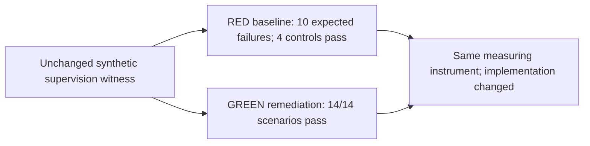

# Digital Qareen — DQ-IV01 focused supervision replay


## Axiom_0 — Zero-Data Topology

**Foundational design thesis — not a mathematical theorem.** More observations do not grant an AI agent execution authority. Explicit, scoped human authorization must be checked independently at the point of action. An agent may propose an operation; policy determines whether it is permitted; infrastructure enforces the decision; and evidence records the outcome.

**Zero-Data** here means minimizing the retention and exposure of raw sensitive payloads. It does **not** mean that the gateway stores no state: scoped authorization, idempotency, budget and audit evidence can still be necessary. Neither reducing data nor adding constraints automatically reveals a person's intent.

**AI Can Propose.**  
**Policy Must Authorize.**  
**Infrastructure Must Enforce.**  
**Evidence Must Prove.**

### RED → GREEN: published DQ-IV01 supervision witness



The diagram summarizes the **published DQ-IV01 synthetic replay described below**. It does not establish a mathematical limit, production readiness, or publication of later private engineering milestones.

---

Disclosure-limited research candidate. Not a production release or security certification.

Two five-file source sets reproduce the original L2-C7 and L3-C8 supervision witness. The witness is unchanged. The source sets are subsets, not full commit trees or an executable Git history. The manifest records the author's locally checked original Git commit, blob and SHA-256 identities. A reviewer without access to the original commit trees cannot independently verify original commit membership from this package alone. The original evidence is retained separately.

## Replay

Inspect the code first. In an isolated disposable environment without live credentials or network access, use Python 3.14.0 (the locally verified version). From this directory run:

```sh
python -I -S -B replay.py
```

The harness extracts selected definitions and simulates I/O. It does not start the full application, PostgreSQL or live providers. Python isolation flags are not an OS security sandbox. No third-party dependencies are intended for this focused witness.

Expected: RED reproduces ten failures and four passing controls (wrapper exit 0); GREEN has fourteen passing scenarios; fatal child exit 1; graceful child exit 0. The runner checks individual outcomes, not just exit codes. It writes logs and a result receipt to a new local temporary directory. Review logs before sharing them; they may contain local paths.

The author's local replay passed on Python 3.14.0. An external reviewer reported an independent offline replay on Python 3.13: all ten source pins matched; RED produced ten expected failures plus four passing controls; GREEN passed 14/14; and both child-process exit outcomes matched the published descriptions. The reviewer did not independently verify the private original Git commit membership or the original signing authority. This report is not a production validation or endorsement. This package covers the focused supervision witness, not the full 67-scenario regression suite, durable cross-worker recovery, or live production validation.

## License and attribution

Digital Qareen **DQ-IV01** is a **source-available, noncommercial research
package**, not an OSI-approved open-source release.

- Source code, the RED/GREEN synthetic witness, `replay.py`, and executable
  or machine-readable verification artifacts: **PolyForm Noncommercial
  License 1.0.0**. See [LICENSE](LICENSE) and [NOTICE](NOTICE).
- Original narrative research documentation: **CC BY-NC 4.0**. See
  [LICENSE-DOCUMENTATION.md](LICENSE-DOCUMENTATION.md).
- See [LICENSING.md](LICENSING.md) for the precise scope, third-party
  dependency caveats, and a separate-commercial-license pathway.

Required Notice: Copyright 2026 Abdalrahman Alakhras. Digital Qareen (DQ-IV01) public research package.

These licenses apply only to the identified publicly distributed DQ-IV01
package and to the owner's rights in its contents. They do **not** license
the unpublished private engineering repository. Permission for commercial
uses outside the applicable license grant must be obtained separately.

The replay performs synthetic dependency substitution and AST evaluation;
it is **not** an adversarial-code security sandbox or proof of production
behavior. No production readiness or independent private-Git history
membership is claimed.

## Manifest enforcement and security boundary

The public replay driver now checks the explicit AST extraction contract and
raw-source-line SHA-256 hashes in `manifest.json` before launching any witness
subprocess. The runner separately verifies the full source SHA-256 hashes and
Git blob identities. The RED/GREEN `is_healthy` selection asymmetry is explicit.
This is a synthetic-dependency AST replay, **not** a hostile-code security
sandbox: selected definitions execute with Python builtins. Review the code
first, then run only in a disposable, unprivileged environment with no live
secrets, production database, provider credentials or network access.
The replay does not prove operation against a real PostgreSQL pool, real OS
signals, or independent membership in the unpublished original private commits.

The software is made available under PolyForm Noncommercial License 1.0.0;
original narrative documentation under CC BY-NC 4.0, as detailed in
`LICENSING.md`. This is source-available noncommercial distribution, **not** an
OSI-approved open-source license. No terms apply to unreleased private code.
